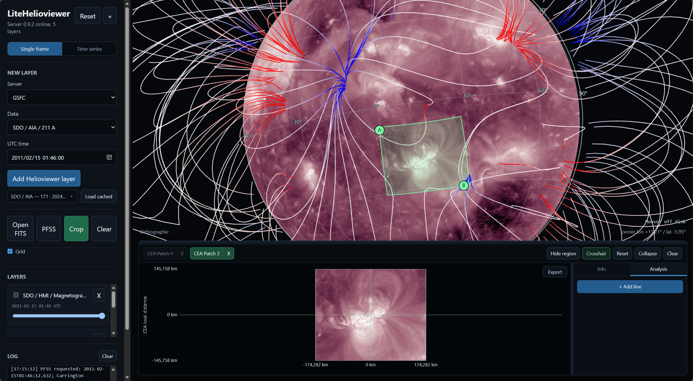
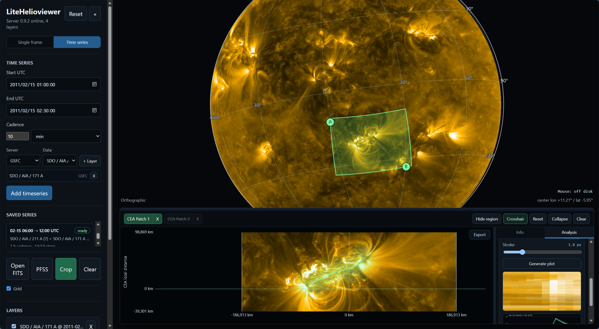

# LiteHelioviewer

[English](README.md) | 中文

一个轻量的本地网页版太阳图像浏览器，数据来自 Helioviewer API。想法源于 [JHelioviewer-SWHV](https://github.com/Helioviewer-Project/JHelioviewer-SWHV)——那个项目很成熟，但日常只想快速看一眼太阳时有点重。LiteHelioviewer 保留了最常用的流程：加载 SDO/HMI、AIA、LASCO 近期的图，叠加图层，转动日面；又加上了我一直想要的小功能：圈一块区域细看、在上面画线分析、播放时间序列。除了下载图像本身，所有东西都在本地运行。



## 快速开始

Windows：双击 `run-litehelioviewer.bat`。它会自动找到 Python 3.9+，首次运行时安装依赖，然后启动后端并打开浏览器。

其他系统：

```
pip install -r requirements.txt
python start.py
```

## 单帧模式

选好数据源、日期和时间，加载。鼠标拖动转动日面，滚轮缩放。也可以把本地 FITS 文件拖进窗口，或者叠加 PFSS 磁力线。不同时刻的图层可以叠在同一视图里——每帧都会旋转到统一的卡灵顿坐标上，太阳上的结构自然对齐。

下载过的数据都会进入本地 `data/` 缓存并反复复用：**Load cached** 列表可以瞬间重新加载任何一帧，不走网络。

点 **Crop** 后在日面上拖出两个点圈定区域，每个区域会在下方以 CEA 投影的子图打开，坐标轴单位是千米；子图可以缩放、拖动。子图上可以画分析线——手绘或贝塞尔曲线，可设宽度和高斯加权——点绘图按钮会生成沿线的拉直条带和对应的强度曲线。

## 时序模式

在侧栏顶部切换到 **Time series**。选好来源和数据类型，点 **+ Layer**（可以多通道叠加），设好起止时间和时间间隔，然后点 **Add timeseries**。帧会在后台下载进同一个本地缓存，序列保存在 **Saved series** 里，日后随时可以重新 load——帧文件已经在盘上，重新加载是秒开的。

Load 之后序列的图层会出现在 LAYERS 栏里，透明度照常可调。拖动时间轴或点播放；在任何一帧上画的 crop 都会钉在同一个卡灵顿位置上，跟着太阳自转走，很适合追踪活动区。导出菜单可以把整个序列的 crop 子图导出为 PNG 序列；在 Analysis 里给一条线选 "whole series"，就能生成 time-distance 拼接图和对应的光变曲线。



两件值得知道的事：

- 默认时间间隔是数据源本身最密的档位（比如 HMI 是 45 秒），往往比你需要的密——可以自己填数字，单位选 sec/min/hour/day。下载过程中遇到任何问题，侧栏左下角的 LOG 会写明原因。
- 序列帧数上限是 300。如果确实需要更多，去掉 `litehelioviewer_app/series.py` 里的 `MAX_STEPS` 即可。

## 近期更新

- 时序模式：整段序列下载、播放、跨帧固定卡灵顿位置的 crop、导出 PNG 序列。
- time-distance 分析：序列上画的线可以按整条序列渲染拼接图。
- 不同时刻的图层叠加时统一到卡灵顿坐标。
- 下载的帧按来源分类存放，跨会话复用。
